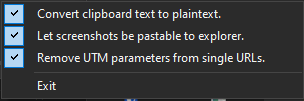

ClipBird clipboard utility for windows.

This tray app listens for clipboard updates and performs the following menu selectable options:

1. When copied content includes an image, it
keeps the image available for pasting into apps and also adds a PNG file format
so it can be pasted into File Explorer as a new file. The PNG is stored in the
ClipBird folder under the Windows temporary directory and is removed when
the clipboard is next successfully replaced while the app is running. If the
app exits while that image is still on the clipboard, the PNG is retained so
the clipboard remains usable.

2. When copied content includes text, the app
replaces the clipboard formats with plain Unicode text, preserving the text
without rich formatting. Clipboard contents are not logged or displayed.

3. Remove UTM parameters from single URLs to strip `utm_` query
  parameters from a copied HTTP or HTTPS URL. This option is enabled by default
  and works independently of plaintext conversion.

Choose Exit from the tray menu to stop monitoring and close the app.

The app uses an invisible form handle to receive Windows clipboard update
messages. The clipboard listener is registered with that handle and removed
when the app closes.

Build and debug:
- In VS Code, run the default build task, "MSVC: Build ClipBird".
- Use the "ClipBird (MSVC)" launch configuration to build and debug.
- These configurations require Visual Studio Build Tools 2022, the MSVC C++
  toolchain, the .NET Framework 4.8 targeting libraries, and the Windows SDK.

Tests:
- Run the "MSVC: Test ClipBird" task for URL-cleanup unit tests, processing
  policy tests, and Windows clipboard/image lifecycle integration tests.
- The integration tests temporarily replace and then restore the current
  clipboard. Close all running ClipBird instances before starting the test task.
